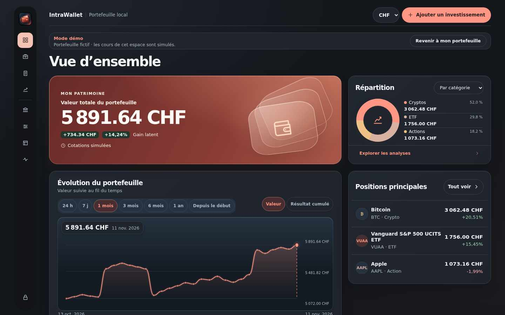
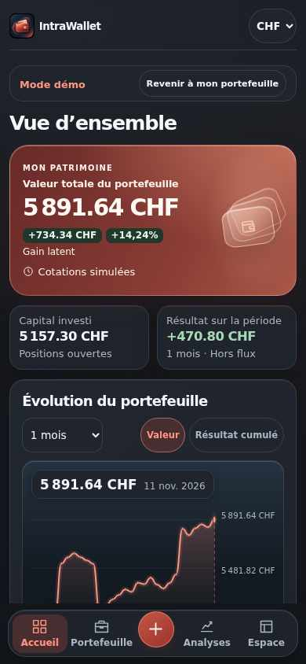
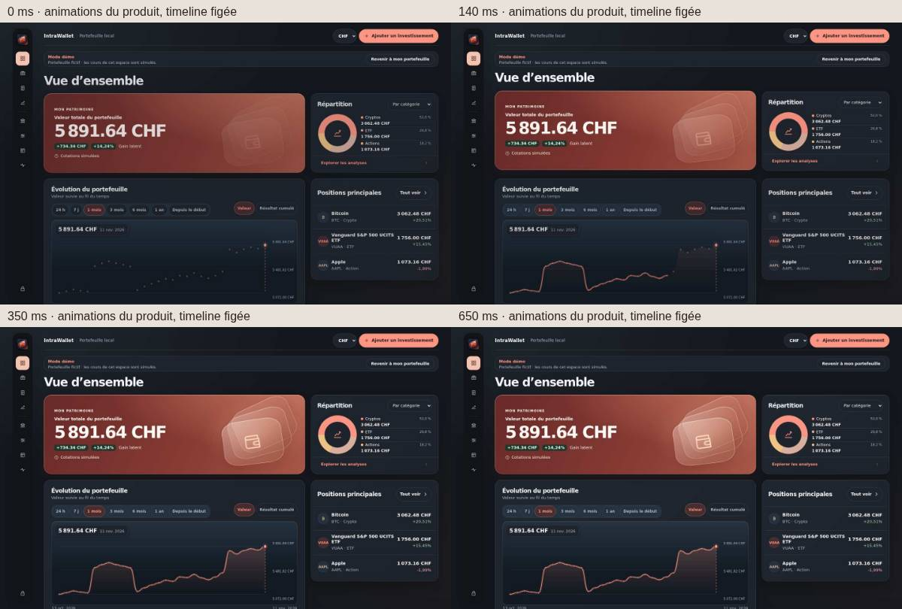

# IntraWallet V8 — livraison de la refonte Signature

La V8 renforce la composition du dashboard, rapproche le graphique du patrimoine sur mobile et harmonise les écrans financiers. Le logo, la carte corail et ses trois cartes translucides sont conservés. Aucun calcul financier, fournisseur de cours ou format de sauvegarde n'a été modifié.

Branche : `refonte-premium-intrawallet`. HEAD constaté au début du lot : `2a7586829b74efcc9b0e837f43c34634db20a7d0`, contenant les consignes V8. La branche de refonte existante a été poursuivie. Référence visuelle V7 : `dbf7133da087d511702b5542052a6c96a6f1508e`.

**Aucun merge dans main, déploiement, tag ou publication de release.** La version du package reste `0.3.0-beta.6`. Le site de production et les APK publiés restent inchangés.

## Avant / après

Même jeu de démonstration, date figée au 11 novembre 2026, Chromium Linux.

| Vue | Avant V7 | Après V8 |
| --- | --- | --- |
| Graphite, 1440 × 900 | [Avant desktop](assets/v8/avant-dashboard-desktop.jpg) | [Après desktop](assets/v8/dashboard-desktop.jpg) |
| Graphite, 390 × 844 | [Avant mobile](assets/v8/avant-dashboard-mobile.jpg) | [Après mobile](assets/v8/dashboard-mobile.jpg) |





[Graphique après défilement](assets/v8/graphique-mobile.jpg) · [Signature clair](assets/v8/dashboard-signature.jpg) · [Tablette 768 px](assets/v8/dashboard-tablette.jpg) · [Desktop 1920 px](assets/v8/dashboard-large.jpg)

Les captures ont été ouvertes et inspectées. Cette inspection a fait corriger la hauteur excessive de Répartition, les commandes du graphique mobile sur deux lignes, la coupure de « CHF » dans les plateformes et un espace vide sous la navigation mobile. Ce dernier venait d'éléments positionnés absolument hors du conteneur de défilement ; le conteneur est désormais positionné et un test interdit le double défilement du document.

## Composition et inspirations

**Vision UI**, référence principale : la capture officielle et les sources ont été consultées. La hiérarchie entre grande zone d'identité, graphique central et modules compacts est transposée au patrimoine. Surfaces, liserés et ombres créent le relief ; le thème bleu et les illustrations de Vision ne sont pas repris.

**RecehTok** : écran Figma consulté. Inspiration pour la place centrale du graphique et la juxtaposition des montants avec des cartes compactes. Pas de copie de sa palette violette ni de ses données.

**Horizon UI** : README et image officielle inspectés. Ses KPI courts, surfaces calmes et grands modules de visualisation confortent la séparation entre indicateurs et analyse.

**Purity UI** : README et image officielle inspectés. Référence secondaire pour l'équilibre entre surfaces claires, modules sombres et séparation des zones. Ses interfaces interactives complètes n'ont pas été auditées.

Sources : [Vision UI React](https://github.com/creativetimofficial/vision-ui-dashboard-react), [RecehTok Figma](https://www.figma.com/design/9DFHrsnbCjJi1ZaBBxaZHZ/Free-Crypto-Dashboard---RecehTok-Dark--Community-?node-id=11-0), [Horizon UI](https://github.com/horizon-ui/horizon-ui-chakra), [Purity UI](https://github.com/creativetimofficial/purity-ui-dashboard). Aucun de leurs assets ou frameworks n'est embarqué dans IntraWallet.

Le principe **deux couleurs calmes + un accent fort** est conservé : crème/ivoire ou anthracite/graphite pour les surfaces ; corail pour l'identité, l'action principale et les sélections. Les gains/pertes conservent leurs couleurs sémantiques, leurs signes et leurs libellés.

### Desktop

À partir de 1280 px : douze colonnes, patrimoine 8 / répartition 4 ; graphique 8 / positions 4 ; quatre KPI ; activité, groupes éventuels et cotations en dessous. Les panneaux compacts ne sont pas artificiellement étirés.

La fiche d'actif place le graphique avant le résumé de position, avec deux colonnes sur grand écran. Les analyses disposent de barres de contribution normalisées à partir des gains déjà calculés. Cartes, tableau, plateformes, groupes et formulaires utilisent les mêmes surfaces.

### Tablette et mobile

Entre 901 et 1279 px : patrimoine et graphique larges, modules secondaires redistribués sur deux colonnes. Jusqu'à 900 px : navigation mobile et parcours vertical ; seuls deux KPI utiles précèdent le graphique. Les autres informations restent accessibles en dessous.

L'application mobile utilise une grille de hauteur `100dvh`. Le contenu défilable et la navigation occupent deux rangées distinctes, sans superposition. Les modales gardent leur zone défilable et leurs actions ; les safe areas sont prises en compte. Un changement de page revient en haut, tandis que les liens vers les sections des Paramètres conservent leur destination.

Les grands montants s'adaptent à la largeur disponible et peuvent revenir à la ligne avant la devise. Le nouveau composant `MoneyText` empêche la coupure à l'intérieur de CHF/EUR/USD, sans changer l'arrondi ou la valeur.

## Thèmes et composants communs

Les valeurs existantes de `--accent`, `--hero`, `--bg`, `--surface`, `--ink`, `--muted`, des séries de graphiques et des couleurs financières ont été comparées : elles sont inchangées.

Les nouveaux tokens portent sur les matières : fond et bord de panneau, ombre, surface de widget, fond et grille du graphique, halo d'ambiance, navigation et fenêtres flottantes. Les tableaux et surfaces de lecture financière restent opaques. Le flou est réservé aux éléments superposés et à la navigation, avec un repli opaque.

| Thème | Rendu inspecté |
| --- | --- |
| Signature | Crème chaleureux, panneaux ivoire, carte corail |
| Graphite | Anthracite profond, surfaces graphite, accents lisibles |
| Champagne | Surfaces mates et ambiance atténuée |
| Noir OLED | Fond noir, surfaces presque noires, halo supprimé |

[Champagne](assets/v8/dashboard-champagne.jpg) · [OLED](assets/v8/dashboard-oled.jpg)

Les miniatures montrent rail, patrimoine, graphique et widget, avec « — CHF » plutôt que des montants fictifs. Les clés de préférences existantes restent compatibles ; mode, variantes et densité sont persistés. La police système est conservée : aucune police distante à charger. Les montants utilisent les chiffres tabulaires.

## Écrans et états inspectés

[Planche desktop Graphite](assets/v8/parcours-desktop.jpg) · [Planche mobile Signature](assets/v8/parcours-mobile.jpg)

Ces planches couvrent Portefeuille Tableau/Cartes, fiche d'actif, Transactions, Analyses, Plateformes, Espace, Paramètres, Diagnostic, menu Ajouter et formulaire d'investissement. Les planches permettent de vérifier la composition ; les PNG à taille réelle sont disponibles dans les artefacts CI.

[Groupe estimatif](assets/v8/groupe-mobile.jpg) · [Formulaire groupé](assets/v8/formulaire-groupe-mobile.jpg) · [Composition](assets/v8/composition-groupe-mobile.jpg) · [Allocations du formulaire](assets/v8/allocations-formulaire-mobile.jpg) · [Très grand montant](assets/v8/montant-long-mobile.jpg)

Le scénario complémentaire utilise 27 actifs, plusieurs plateformes, des noms longs, un groupe estimatif, des coûts inconnus, des cours manquants et des cotations anciennes. Les données synthétiques sont injectées uniquement dans la base de démonstration des tests. Le portefeuille vide est aussi capturé. CHF, EUR et USD sont vérifiés.

## Animations

| Interaction | Durée et déclencheur |
| --- | --- |
| Entrée des modules | 275 ms, décalage de 48 ms plafonné à 240 ms, changement de page |
| Courbe et halo | 560 ms, changement de période |
| Remplissage de la courbe | 450 ms |
| Indicateur de navigation et de période | 280 ms, sélection |
| Cartes | 210 ms, survol |
| Portefeuille décoratif | 480 ms après 100 ms ; survol 330 ms sur desktop à pointeur fin |
| Feuille Ajouter | Entrée 280 ms, sortie 140 ms |
| Valeur actualisée | 200 ms |

Les animations V6/V7 sont conservées et leur ordre suit la nouvelle composition. `prefers-reduced-motion` désactive les mouvements et rend les changements immédiats. Aucune bibliothèque d'animation n'est ajoutée.



Cette séquence fige les animations réelles dans le navigateur à 0, 140, 350 et 650 ms. Ce n'est pas un enregistrement vidéo sur téléphone.

## Validation technique

Exécution dans GitHub Actions : Ubuntu 24.04, Node 24, Chromium Playwright. Les captures issues du navigateur CI ont été récupérées et inspectées.

[Exécution finale](https://github.com/LeKT01/portefeuille-local/actions/runs/44033223600)

| Commande | Résultat final |
| --- | --- |
| `npm ci` | Réussite |
| `npm test` | 59 tests réussis |
| `npm run check` | TypeScript valide |
| `npm run build` | Build et worker générés |
| `npm run test:browser` | 72 tests réussis ; scénarios de capture à la demande ignorés ici |
| `INTRAWALLET_CAPTURE=1 npx playwright test signature-capture.spec.ts --workers=1 --reporter=line --output=review-captures` | 21 scénarios réussis, dont 3 références externes |
| `npm run test:visual -- --output=visual-comparison` | 4 tests réussis, couvrant 12 images de référence |

Les anciennes références ont d'abord produit les différences attendues. Les douze nouvelles images ont été ouvertes avant leur remplacement : Accueil, Portefeuille et Espace, clair/sombre, 390/1440 px. Aucun `--update-snapshots` aveugle ni commit automatique n'est utilisé. Les comparaisons visuelles de la V8 sont maintenant bloquantes. La V7 est rejouée comme référence historique informative : lors de la revue du 17 novembre, ses quatre comparaisons signalent des écarts de hauteur avec ses anciens PNG. Ses images ne sont pas réécrites et cet écart n'est pas présenté comme une validation réussie de la V7.

Les audits axe couvrent dashboard/préférences dans les quatre variantes et Cartes/Analyses/Transactions en clair et sombre. Deux premières alertes mesuraient des cartes en cours d'apparition translucide ; l'audit mesure désormais l'état stable avec mouvement réduit, sans exclure de règle ou de composant. Un test géométrique intermittent a également été stabilisé : les rectangles sont mesurés dans une seule frame après la fin des animations, sans augmenter la tolérance de 2 px.

### Résolutions réellement testées

- Smartphones : 320 × 568, 360 × 800, 375 × 812, 390 × 844, 414 × 896, 440 × 956.
- Tablettes : 600 × 960, 768 × 1024, 820 × 1180, 1024 × 768.
- Desktop : 1280 × 720, 1440 × 900, 1920 × 1080.
- Hauteurs courtes : 390 × 400 et 844 × 390.
- Zoom 200 % simulé par un viewport CSS de 720 × 450 et un facteur de pixels de 2 ; pas de manipulation du zoom d'un navigateur physique.

Les tests contrôlent bornes des champs/panneaux, collisions, colonnes, accès aux actions, deux KPI avant le graphique mobile, défilement, menu ancré au déclencheur, clavier, Échap, retour du focus et persistance. Les parcours existants de groupes, allocations, mouvements et sauvegardes restent inclus.

## Développement et compatibilité

| Fichiers | Responsabilité |
| --- | --- |
| Dashboard / App | Composition, activité, groupes et défilement |
| DailyChart / HistoryChart | Halo, lecture de valeur et commandes |
| PortfolioViews / AnalysisViews | Fiches, montants et contributions |
| Appearance / ui | Miniatures de thèmes et composant MoneyText |
| theme.css / signature.css | Tokens, grilles, surfaces, responsive |
| styles.css / workspace.css | Composants communs et retrait des anciens styles de miniatures |
| motion.ts / motion.css | Ordre d'apparition et halo |
| Tests signature / fixtures / captures | Géométrie, accessibilité, états complexes, images et mouvement |
| Workflow / export-review-snapshots | Comparaison V7/candidate et export pour inspection |

Aucune dépendance ajoutée. Aucun changement dans `ledger.ts`, `portfolio.ts`, `currency.ts`, `database.ts`, `quotes.ts`, les sauvegardes, le worker ou la configuration Android. Les distinctions valeur/résultat, positions exactes/allocations estimatives et horodatages de cours sont conservées.

### Liste exacte des fichiers

```text
.github/workflows/premium-review.yml
scripts/export-review-snapshots.mjs
src/AnalysisViews.tsx
src/App.tsx
src/Appearance.tsx
src/DailyChart.tsx
src/Dashboard.tsx
src/HistoryChart.tsx
src/PortfolioViews.tsx
src/motion.css
src/motion.ts
src/signature.css
src/styles.css
src/theme.css
src/ui.tsx
src/workspace.css
tests/browser/signature-capture.spec.ts
tests/browser/signature-fixtures.ts
tests/browser/signature.spec.ts
tests/browser/visual.spec.ts
tests/browser/visual.spec.ts-snapshots/overview-dark-1440-linux.png
tests/browser/visual.spec.ts-snapshots/overview-dark-390-linux.png
tests/browser/visual.spec.ts-snapshots/overview-light-1440-linux.png
tests/browser/visual.spec.ts-snapshots/overview-light-390-linux.png
tests/browser/visual.spec.ts-snapshots/positions-dark-1440-linux.png
tests/browser/visual.spec.ts-snapshots/positions-dark-390-linux.png
tests/browser/visual.spec.ts-snapshots/positions-light-1440-linux.png
tests/browser/visual.spec.ts-snapshots/positions-light-390-linux.png
tests/browser/visual.spec.ts-snapshots/space-dark-1440-linux.png
tests/browser/visual.spec.ts-snapshots/space-dark-390-linux.png
tests/browser/visual.spec.ts-snapshots/space-light-1440-linux.png
tests/browser/visual.spec.ts-snapshots/space-light-390-linux.png
docs/refonte-premium-v8.md
docs/assets/v8/avant-dashboard-desktop.jpg
docs/assets/v8/avant-dashboard-mobile.jpg
docs/assets/v8/dashboard-desktop.jpg
docs/assets/v8/dashboard-mobile.jpg
docs/assets/v8/graphique-mobile.jpg
docs/assets/v8/dashboard-signature.jpg
docs/assets/v8/dashboard-tablette.jpg
docs/assets/v8/dashboard-large.jpg
docs/assets/v8/dashboard-champagne.jpg
docs/assets/v8/dashboard-oled.jpg
docs/assets/v8/parcours-desktop.jpg
docs/assets/v8/parcours-mobile.jpg
docs/assets/v8/groupe-mobile.jpg
docs/assets/v8/formulaire-groupe-mobile.jpg
docs/assets/v8/composition-groupe-mobile.jpg
docs/assets/v8/allocations-formulaire-mobile.jpg
docs/assets/v8/montant-long-mobile.jpg
docs/assets/v8/animation-dashboard.jpg
```

### Commits créés

| Commit | Contenu |
| --- | --- |
| `1147a3f` | Revue V7/V8 sans déploiement |
| `fe9f6be` | Composition et design system V8 |
| `0966ba7` | Tests géométriques et données complexes |
| `5d9832c` | Devises lisibles et audits stables |
| `91cbf7f` | Défilement mobile et séquence d'animation |
| `bcfc89a` | Références desktop inspectées |
| `4ae6c97` | Références mobiles inspectées et comparaison bloquante |
| `117d0a9` | Comparaison historique V7 informative, contrôles V8 bloquants |
| `dc6fa56` | Géométrie mesurée au repos dans une seule frame |
| Commit contenant ce rapport | Captures durables et bilan final |

Le code applicatif validé correspond à `4ae6c97` ; `117d0a9` ajuste le workflow de revue et `dc6fa56` stabilise uniquement les mesures des tests. Le dernier commit de livraison ajoute uniquement ce rapport et les images.

## Limites restantes

- Pas d'essai physique sur iPhone/Android, de clavier virtuel natif ou de Safari/WebKit dans ce lot.
- L'audit automatique et le parcours clavier ne sont pas une certification exhaustive WCAG.
- Les appels de cotations réels et les écarts avec Revolut ne sont pas réévalués dans cette refonte.
- Les captures normales montrent les portions visibles ; les vues complémentaires couvrent le graphique défilé et les allocations. Toutes les combinaisons de données/appareils ne sont pas prétendues validées.
- Les démos interactives complètes des références externes ne sont pas toutes accessibles ; les visuels effectivement consultés sont précisés plus haut.
- La branche est prête à tester. Toute fusion ou publication reste une étape séparée.

## Commandes pour tester sur le PC

Dans PowerShell :

```powershell
cd C:\Tools\portefeuille-local
git fetch origin
git switch refonte-premium-intrawallet
git pull --ff-only origin refonte-premium-intrawallet
npm ci
npm run dev
```

Ouvrir `http://127.0.0.1:4173/?demo=1#overview` pour retrouver les données des captures. Ces commandes ne publient rien.
